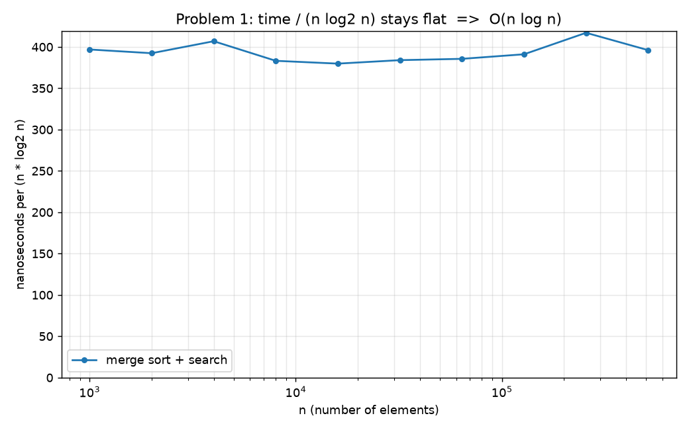
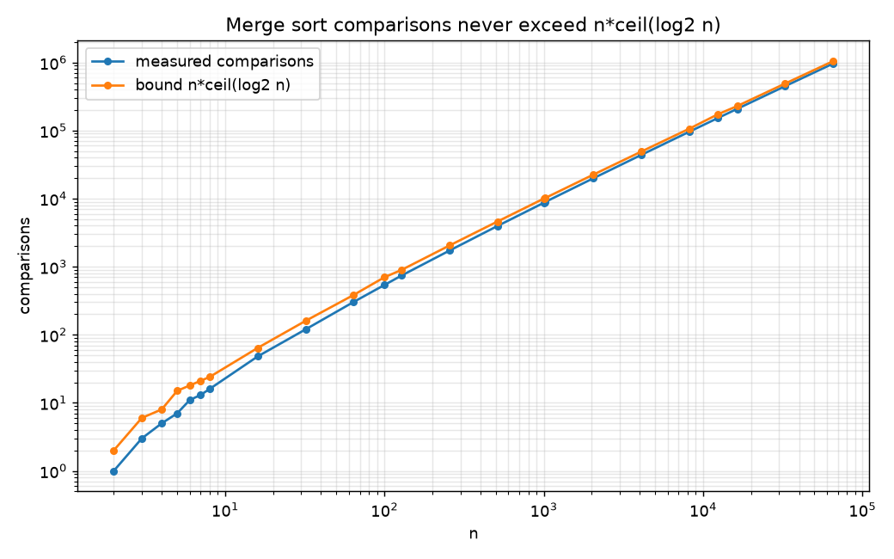
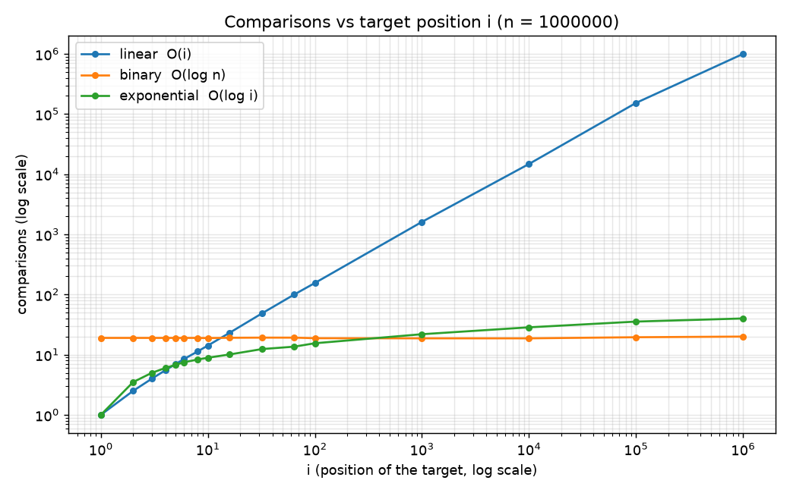
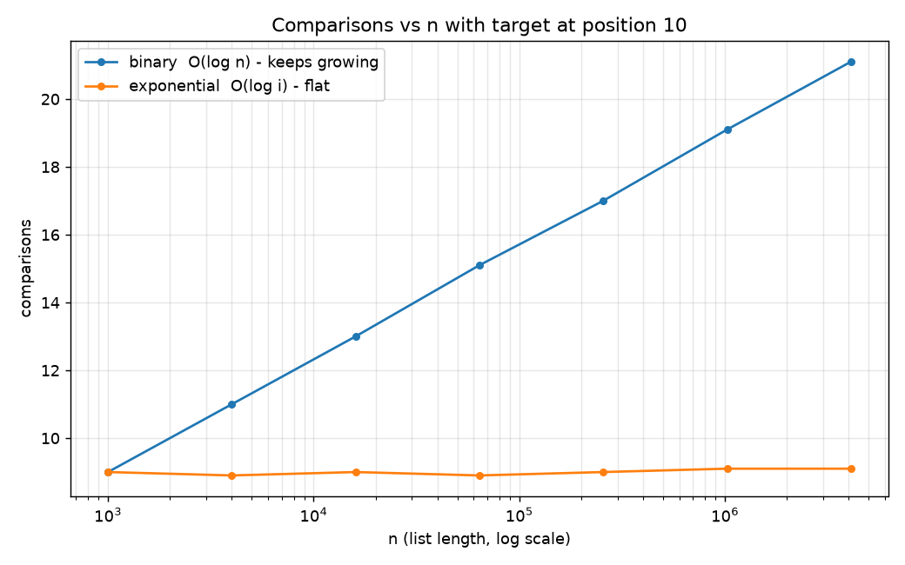

# CPS 232 Fall 2026 – HW2: Searching Algorithms

**Group members:** 1. Andrew Wilk

## 1. Problems

1. **Membership in an unsorted set (50 pts).** Given a set `S` of `n` natural numbers and a number `w`, decide whether `w` is in `S`.
2. **Searching near the front of a sorted list (50 pts).** Given a sorted list of `n` numbers and a target at a small position `i` (`i << n`), search faster than `O(log n)`.

## 2. Files

| File | Purpose |
|---|---|
| `search_algorithms.py` | All algorithms, correctness tests, experiments, plotting |
| `results/` | CSV tables and PNG graphs produced by the script, plus `terminal_output.txt` (output of the full run) |
| `submission/` | The written answers with proofs (Word) |
| `notes/` | Study guide for the in-class defense and step-by-step GitHub instructions |
| `requirements.txt` | Needs `matplotlib` for the graphs |

Run: `pip install -r requirements.txt` (already installed with Anaconda), then `python search_algorithms.py` (or `--quick` for a fast test).

## 3. Algorithms

**Problem 1 – merge sort + binary search.** Sort `S` with a hand-written merge sort, then binary search for `w`. Sorting is `O(n log n)`, each search is `O(log n)`, so the whole job is `O(n log n)`. Correctness is shown with loop invariants and strong induction; the bound `T(n) <= n * ceil(log2 n)` on comparisons is proved by induction.

**Problem 2 – exponential (galloping) search.** Probe positions 1, 2, 4, 8, ... until the value is at least the target, then binary search only the last window. Cost `O(log i)`, independent of `n`, which beats binary search's `O(log n)` whenever `i << n`.

Only primitive operations are used inside the algorithms (loops, comparisons, indexing, append). Built-ins like `sorted` and `in` are used only to test correctness and as a speed baseline.

## 4. Experiments

| Exp | What it shows |
|---|---|
| 1A | Time of merge sort + search vs `n`; time / (n log n) is roughly flat |
| 1B | Measured comparisons never exceed the proven bound `n * ceil(log2 n)` |
| 1C | Sorting once vs scanning every time for many queries (break-even about 28 queries at n = 100,000) |
| 1D | Merge sort on random / sorted / reversed / all-equal / few-distinct inputs |
| 2A | Linear vs binary vs exponential as the target position `i` grows (n = 1,000,000) |
| 2B | `i` fixed (10 and 1000), `n` grows to about 4 million: binary grows, exponential stays flat |
| 2C | Head-to-head table for i = 1, 10, 100, 1000 (hits and misses) |

## 5. Conclusions

* Merge sort + binary search is correct and `O(n log n)`; every later search on the same set costs only `O(log n)`.
* Exponential search is correct and `O(log i)`. At n = 1,000,000 and i = 10 it needs about 9 comparisons versus about 19 for binary search, and its cost does not grow with `n`.
* It is not always better: it makes up to about twice the comparisons of binary search, so it wins only while `i` is below roughly `sqrt(n)`. It is never worse than `O(log n)`.
* Python's built-in `sorted` is faster than our merge sort by a constant factor (it is written in C); both grow as `n log n`.
